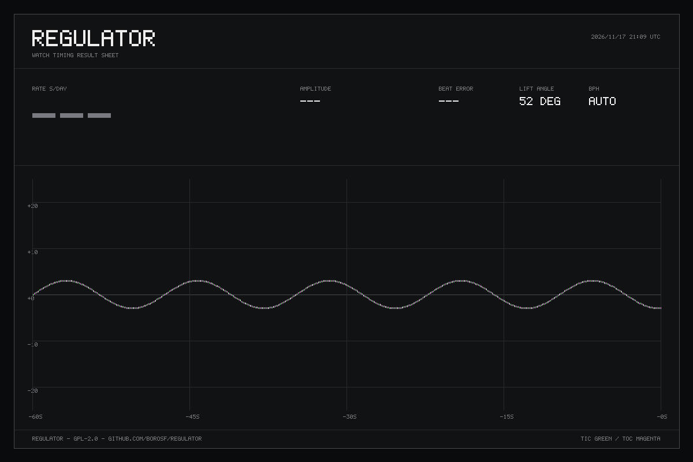

# regulator

A free-software watch timing machine. Put a mechanical watch on a
microphone and regulator measures the rate error, balance amplitude, and
beat error live, with a clean instrument-style interface. A Rust rewrite
of [tg](https://github.com/xyzzy42/tg), the original open-source watch
timing program.



## Build & run

```sh
cargo run -p regulator-gui
```

Windows and macOS work out of the box; on Linux you need
`libasound2-dev` for microphone capture. Prebuilt binaries are on the
[releases page](https://github.com/borosf/regulator/releases).

Headless build (no audio stack):

```sh
cargo build --no-default-features
cargo test
```

## Using it

1. Rest the watch on a microphone — a piezo contact mic or the watch
   directly on a laptop mic both work.
2. Pick the beat rate, or leave it on auto (the detected rate is shown
   once the signal locks).
3. Set the lift angle for the movement (52° is a safe default).
4. Read the rate. The trace confirms it: a rising drift means fast, a
   falling drift means slow, two horizontal bands mean beat error.
   (tic green, toc magenta)
5. To calibrate the sound card, click "calibrate (quartz)" and place a
   quartz watch (exactly 1 tick/s) on the microphone for a minute or two.
   The correction persists between runs.

**Export** produces three files: an SVG chart, the raw trace as CSV, and
a branded JPEG result sheet with all readouts, ready to attach to a
service record.

When no microphone exists (or the build has no audio), regulator runs a
synthetic demo watch automatically.

## Layout

- `crates/regulator-core` — pure DSP: filters, FFT-based period
  detection, waveform folding, rate/amplitude/beat-error computation,
  quartz calibration. No I/O; unit-tested against a synthetic watch
  generator. `src/dsp2.rs` is the next-generation detection chain
  (coherent folded acquisition, matched-filter tracking, regression
  period refit) — it acquires on ticks far too faint for the classic
  estimator; see [docs/dsp2-notes.md](docs/dsp2-notes.md) for the
  benchmark and design notes.
- `crates/regulator-gui` — the application (egui).
- `examples/analyze_wav.rs` — analyze a WAV/MP3/M4A recording from the
  command line; `examples/bench_dsp2.rs` — old-vs-new detection benchmark.
- `icons/regulator.ico` — Windows executable icon, generated by
  `icons/make_icon.py`.

## Improvements over tg

- Partial results: rate, beat error and amplitude are reported
  independently; a missing measurement is blank, not fatal.
- Sub-sample period refinement (parabolic interpolation of the
  autocorrelation peak) for finer rate resolution.
- Cached FFT plans and reused scratch buffers.
- Faster calibration: the quartz fit exits early once the estimate
  converges instead of always collecting 900 seconds.
- Modern cross-platform GUI with result-sheet export.

The original project's documentation is preserved in
[docs/original-readme.md](docs/original-readme.md).

## Known limitations

- Tick events are located by peak search around expected positions, not
  template matching; very noisy recordings may drop events.

## Contributing

See [CONTRIBUTING.md](CONTRIBUTING.md). DSP contributions are very
welcome — the analysis is pure Rust with a synthetic-watch test
harness, so it is easy to experiment with. Attach a WAV recording of a
real watch to issues; recordings make DSP bugs reproducible.

## License

GPLv2. regulator is a derivative work of tg, Copyright 2015 Marcello
Mamino and contributors. The original C source has been removed from
this repository; it remains available at
[tg](https://github.com/xyzzy42/tg), and the analysis algorithms here
are ports of its work.
